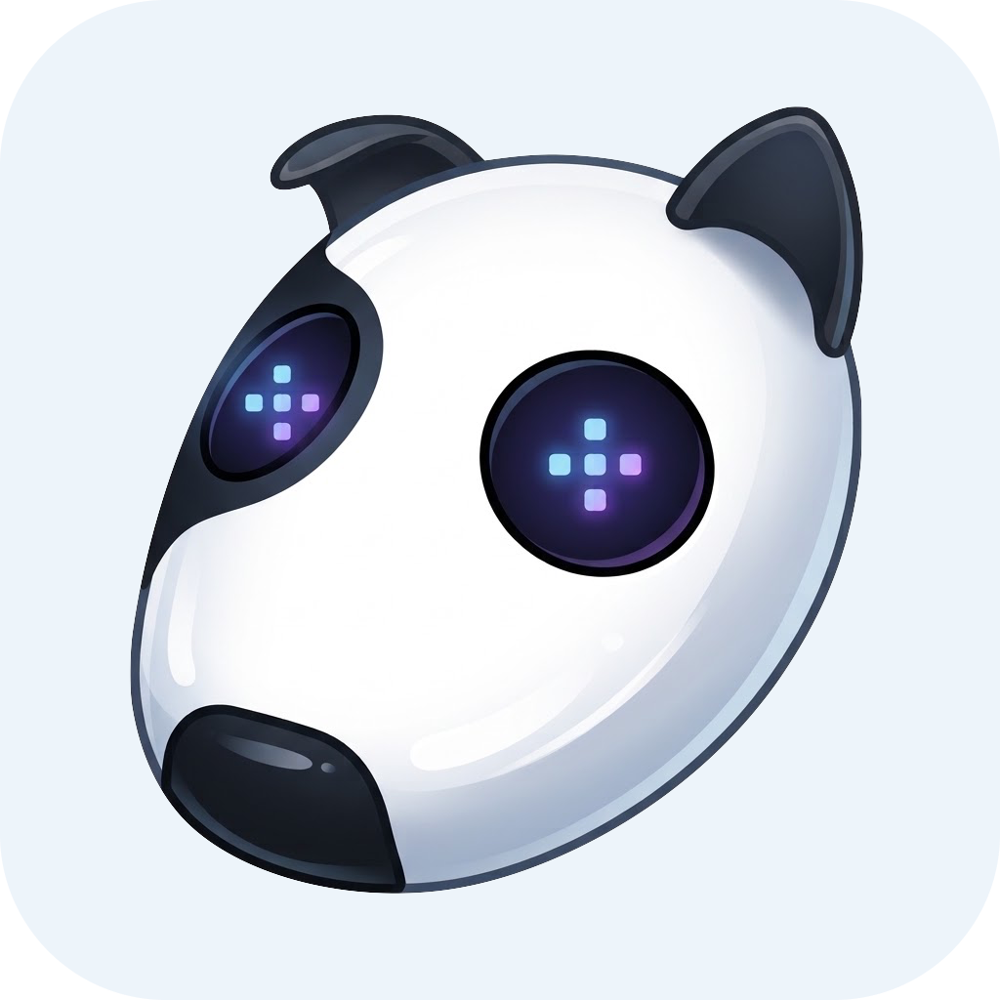
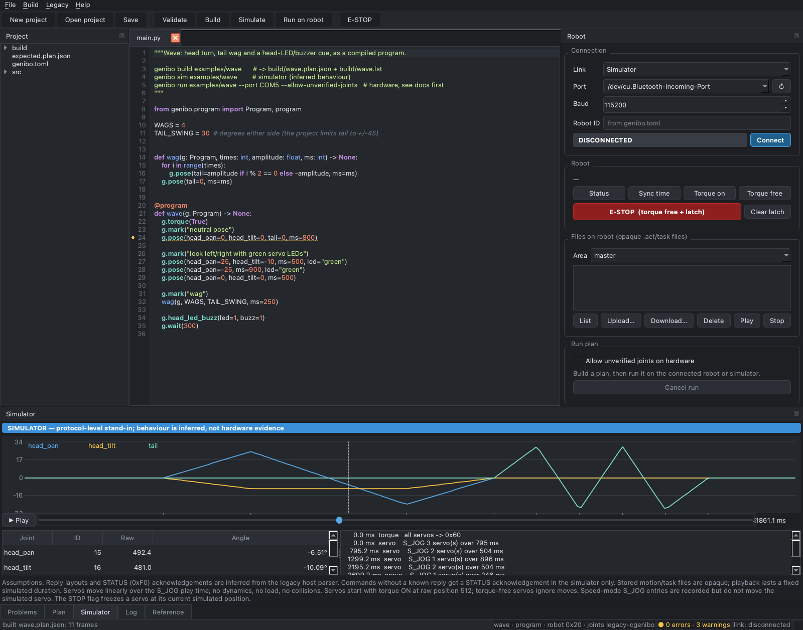
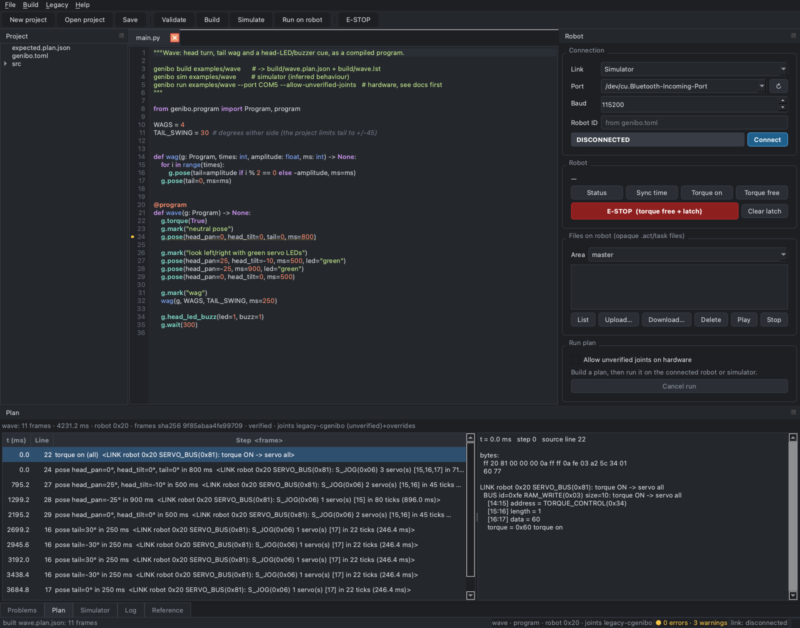
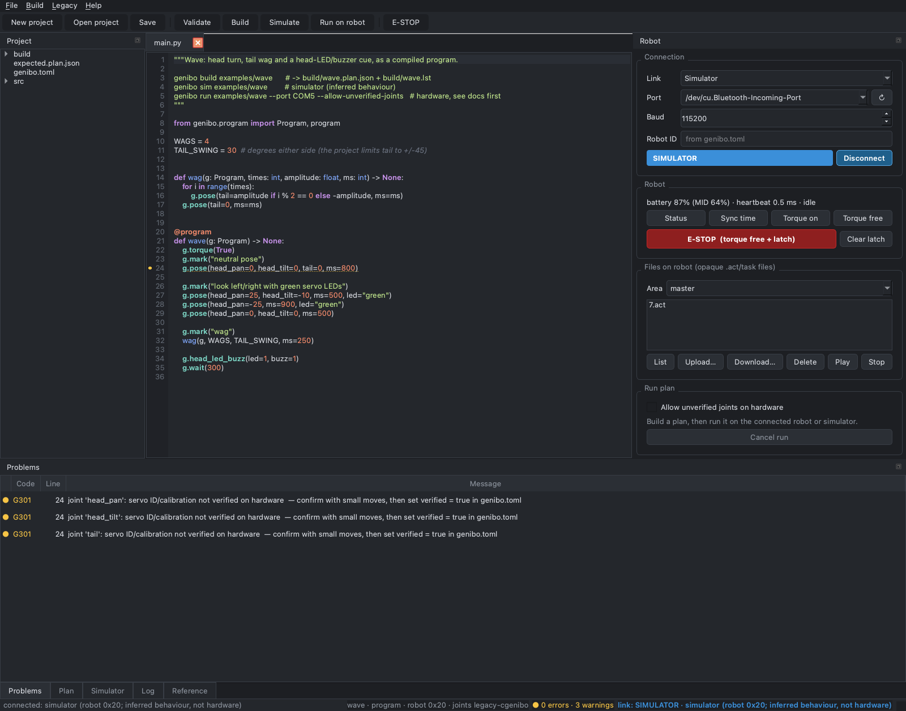

<p align="center">
  
</p>

<h1 align="center">Genibo SDK</h1>

<p align="center">
  Python SDK, compiler, simulator and studio for the Genibo robot
</p>

Python-first tooling for the Genibo robot: a typed SDK, a compiler from Python
programs to verified command plans, a protocol-level simulator, a CLI and a
desktop studio. It succeeds the Genibo parts of the OpenJigWare C# toolkit
([ojw5014/OpenJigWare](https://github.com/ojw5014/OpenJigWare)). The two original
files the compatibility tests need are vendored verbatim in `compat/legacy/`.



## What is verified, and what is not

| Claim | Evidence |
|---|---|
| Every frame the SDK sends is byte-identical to what the legacy C# code sends for the same command | 68 transmit scenarios + 11 numeric tables recorded from the **unmodified** `COjw_25_Genibo.cs` compiled under .NET (`compat/csharp-reference`), compared in `tests/test_golden_csharp.py` |
| The DLLs the legacy examples actually shipped contain that same code | decompile-and-compare, `docs/evidence/binary-comparison.txt` |
| The host stack (encoders, link, reply matching, compiler, player, studio) works end to end | 191 tests (golden, property-based, integration, examples, offscreen studio) |
| **The physical robot accepts and executes these frames** | **Not verified.** No robot was available. See [docs/HARDWARE_TESTING.md](docs/HARDWARE_TESTING.md) |

The robot never runs Python. Python runs on your PC and produces the same
frames the legacy tool sent over Bluetooth serial (or TCP). Details are in
[docs/ARCHITECTURE.md](docs/ARCHITECTURE.md) and [docs/COMPATIBILITY.md](docs/COMPATIBILITY.md).

## Install

Requires Python 3.11+ and [uv](https://docs.astral.sh/uv/).

```bash
cd genibo-sdk
uv sync                    # SDK + CLI + dev tools
uv sync --extra studio     # + the Qt studio (PySide6-Essentials)
uv run genibo doctor       # environment check
```

Plain pip works too: `pip install -e '.[studio]'`.

Serial port names: Windows `COM5`; macOS `/dev/tty.<robot-name>` (after
pairing); Linux `/dev/rfcomm0` (after `rfcomm bind`). `genibo ports` lists them.

## Quick start

```bash
uv run genibo new my-dog                 # compiled-program project
uv run genibo build my-dog               # -> my-dog/build/my-dog.plan.json (+ .lst listing)
uv run genibo inspect my-dog --detail    # every frame, byte by byte, with its source line
uv run genibo sim my-dog                 # replay on the simulator (inferred behaviour)
uv run genibo run my-dog --port COM5     # stream to the robot (asks first; refuses unverified joints)
uv run genibo studio my-dog              # the same, in the GUI
```

A compiled program:

```python
from genibo.program import Program, program


@program
def main(g: Program) -> None:
    g.torque(True)
    g.pose(head_pan=20, tail=0, ms=500, led="green")
    for i in range(4):
        g.pose(tail=30 if i % 2 == 0 else -30, ms=250)
    g.play_motion("7.act", "master", wait_ms=3000)  # a motion file already on the robot
```

A host script (live, can react to replies): `genibo new bot --kind script`, then

```python
from genibo import Genibo, Storage


def main(robot: Genibo) -> None:
    if robot.battery().robot_percent > 20:
        robot.play_motion("7.act", Storage.MASTER)
```

```bash
uv run genibo script bot/src/main.py --sim          # or --port COM5
```

Or use the library directly:

```python
from genibo import Genibo

with Genibo.serial("COM5", robot_id=0x20) as robot:
    print(robot.battery(), robot.list_files())
```

## CLI

| Command | Purpose |
|---|---|
| `genibo new DIR [--kind program\|script]` | scaffold a project (`genibo.toml`, `src/main.py`) |
| `genibo validate [DIR]` | static + semantic checks, no files written |
| `genibo build [DIR]` | compile to `build/<name>.plan.json` and `build/<name>.lst` |
| `genibo inspect PLAN\|DIR [--detail]`, `genibo inspect --hex BYTES` | listing / disassembly / plan verification |
| `genibo sim PLAN\|DIR [--realtime] [--robot-file master:7.act]` | play on the simulator |
| `genibo run PLAN\|DIR --port P [--yes] [--allow-unverified-joints] [--allow-dangerous] [--on-cancel torque_free]` | stream to hardware; refuses unverified servos and state-changing commands found in the frames |
| `genibo script FILE (--sim\|--port P)` | run a host script's `main(robot)` |
| `genibo robot status\|files\|upload\|download\|delete\|play\|stop\|set-time\|torque\|ems\|mpsu-motion\|led-buzz` | one-off robot commands; `--listen S` prints replies |
| `genibo ports`, `genibo doctor` | environment |
| `genibo migrate Form1.cs [-o out.py]` | map legacy C# Genibo calls to the SDK |
| `genibo studio [DIR]` | open the studio |

Global flags: `--log-level debug` shows every TX/RX frame; `--log-format json` gives structured logs.

## Studio

Editor with live diagnostics, Build / Simulate / Run, a plan inspector
(frames ↔ source lines, byte-level breakdown), a simulator timeline with joint
plots, a robot panel (simulator or Bluetooth serial; status, files, torque,
E-STOP), logs with TX/RX frames, an API reference, and legacy tools (C#
migration report, hex decoder, opaque `.act` viewer). The link badge always
says SIMULATOR or HARDWARE.

| Plan inspector | Diagnostics |
|---|---|
|  |  |

## Downloads and packaging

CI (`.github/workflows/build-artifacts.yml`) builds Genibo Studio for Windows x64
(installer + zip), macOS arm64 and x86_64 (DMG), and Linux x86_64 and arm64
(.deb, .rpm, .tar.gz), plus the Python wheel. Every artifact is self-tested
headless, and Linux packages are installed into clean distribution containers.
Tagging `v<version>` publishes a GitHub release. Details, platform minimums,
local builds and signing: [docs/PACKAGING.md](docs/PACKAGING.md).

## Development

```bash
uv run pytest                      # unit, golden, integration, studio (offscreen), examples
uv run pytest -m dotnet            # regenerate golden data from the C# and diff (needs dotnet)
GENIBO_PORT=COM5 uv run pytest -m hardware tests/hardware -s   # physical robot, opt-in
uv run ruff check . && uv run ruff format --check . && uv run pyright
```

Layout: `src/genibo/{protocol,transport,program,sim,legacy,studio}`, `compat/`
(C# reference harness, binary comparison), `examples/` (Ex20 port, compiled
programs with expected plans, host scripts), `docs/`.

## Documentation

* [Architecture](docs/ARCHITECTURE.md): what the legacy system is and how the new one is built
* [Compatibility contract](docs/COMPATIBILITY.md): frames, commands, quirks, evidence, risks
* [Programming model](docs/PROGRAMMING_MODEL.md): compiled programs vs host scripts, `genibo.toml`
* [Migration](docs/MIGRATION.md): legacy → SDK mapping, shim, scanner
* [Hardware testing](docs/HARDWARE_TESTING.md): the checklist that still has to be run
* [Packaging](docs/PACKAGING.md): release artifacts, CI verification, signing
* [Decisions](docs/DECISIONS.md): trade-offs

## Known limitations

* No hardware verification yet (see above).
* Joint IDs/calibration in the default profile are unverified guesses taken
  from legacy constants and a code comment.
* Robot-side `.act`/task formats are unknown: the SDK stores, fetches, lists
  and plays them, but cannot create or convert them.
* Simulator replies, acknowledgements and timing are inferred from the legacy
  host parser.
* The TCP (6100..6105) path is implemented and golden-tested but its
  availability on real Genibo models is unknown.
